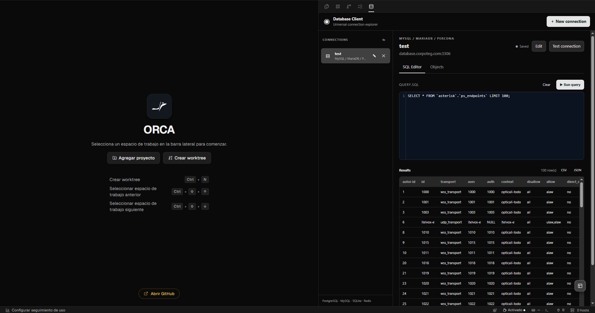

# Ork DBclient

Browse and query PostgreSQL, MySQL/MariaDB/Percona, MSMySQL, SQLite and Redis from an Orca sidebar panel.

Current version: `0.1.0`. This is an early release. Use a least-privilege database account and back up data before running destructive statements.  
  


## Features

- Connection profiles for PostgreSQL, MySQL-compatible servers (MySQL, MariaDB and Percona), Microsoft SQL Server,SQLite and Redis.
- Add, edit and delete connections. Passwords are kept in Orca plugin secrets and are never returned to the panel.
- Optional database/schema selection:
  - PostgreSQL: blank uses `postgres`.
  - MySQL-compatible: blank lists every accessible non-system database.
  - Microsoft SQL Server: blank uses the account's default database.
  - Redis: database number, default `0`.
- Object browser grouped by database/schema with collapsible groups and a one-click `SELECT` shortcut.
- CodeMirror SQL editor with dialect-aware highlighting and completion.
- Query results with row count, truncation notice, and CSV/JSON export through Orca's save dialog.
- Column filters in the results table: click the funnel icon to add a `LIKE '%value%'` condition to the editor query and re-run it, combining additional filters with `AND`.
- Redis command console for commands such as `PING`, `INFO` and `SCAN`.
- Optional TLS for PostgreSQL, MySQL, Microsoft SQL Server and Redis connections.
- Self-contained UI: no CDN requests and no telemetry.

## Supported engines


| Engine                  | Driver                | Notes                                              |
| ----------------------- | --------------------- | -------------------------------------------------- |
| PostgreSQL              | `pg`                  | Optional TLS with certificate verification.        |
| MySQL, MariaDB, Percona | `mysql2`              | Optional TLS using the driver's TLS defaults.      |
| Microsoft SQL Server    | `mssql` (tedious)     | Optional TLS with certificate verification.        |
| SQLite                  | Node.js `node:sqlite` | Requires Node.js 22.5+ in the Orca worker runtime. |
| Redis                   | `ioredis`             | Optional TLS using the driver's TLS defaults.      |


## Requirements

- Orca desktop `>=1.4.246`.
- Node.js 22.5+ for SQLite. Other engines still work when SQLite is unavailable; the plugin reports the missing runtime requirement.
- Node.js 22.5+ and npm to build the plugin.

## Install from GitHub

Once the repository is public:

1. In Orca, open **Settings -&gt; Plugins** and turn on plugins.
2. Add the repository as a Git plugin:
   ```text
     https://github.com/MichelVelzr/ork-dbclient
   ```
3. Review the requested permissions and approve the plugin. Its key is `michelvelzr.ork-dbclient`.
4. Open the **Database Client** panel from the right sidebar.

The directory listing is available at [https://www.onorca.dev/plugins/MichelVelzr/ork-dbclient](https://www.onorca.dev/plugins/MichelVelzr/ork-dbclient) after the repository has the `orca-plugin` topic.

The plugin uses Orca's `trusted-worker` execution profile: its worker runs in a separate Node.js process with the same operating-system access as the Orca user. Install only code you trust.

### Local development

```bash
npm install
npm run check
npm run build
npm run validate
orca plugin dev load .
```

You can also add this folder under **Settings -&gt; Plugins -&gt; Development folders**. Approve the plugin when Orca prints the fingerprint. Local loads use the key `local.ork-dbclient`.

## Build

```bash
npm install
npm run check
npm run build
```

The build creates `dist/main.mjs`, `dist/panel.html`, `dist/panel.js` and `dist/panel.css`. The worker bundles `pg`, `mysql2`, `mssql` and `ioredis`; the panel bundles CodeMirror locally. `dist/` is committed on purpose because Orca installs the repository as-is and does not run a build during installation.

To load the plugin from a local folder, build a clean package first:

```bash
npm run package
```

This writes `release/` with only the manifest, `dist/`, `assets/` and docs. Load that folder in Orca. Do not load the repository root: Orca allows at most 2000 files / 50 MB per plugin and only skips the root `.git`, so `node_modules/` would exceed the limit. Development folders (`orca plugin dev load .`) skip `node_modules/`, `.git/` and `.orca/` automatically.

`npm run validate` runs `orca plugin validate .` and requires the Orca CLI. Add it to your `PATH` or run it from an Orca terminal.

## Usage

1. Open the **Database Client** panel.
2. Select **Add connection**.
3. Choose the engine, enter a name and the connection details, then save.
4. Use **Test connection** to verify the settings.
5. Use the **Query** tab to run SQL and export the first 500 rows as CSV or JSON.
6. Use the **Objects** tab to expand a database and select a table or view.
7. For Redis connections, use the **Redis** tab to send commands to the selected database.

Passwords are saved only when the field is filled. Editing a connection and leaving the password blank keeps the existing password. Deleting a connection also deletes its stored password.

## Permissions and security

- The worker requests only the plugin's own storage and secrets host capabilities. It does not request workspace, terminal, agent or notification access.
- SQL statements are executed exactly as entered. Use a database account with the minimum privileges required.
- TLS certificate verification is enabled for PostgreSQL and Microsoft SQL Server when TLS is selected. MySQL and Redis use their driver TLS defaults; configure certificates at the server or OS level as needed.
- Redis console commands are sent to the selected server and can be destructive. Use an appropriately restricted Redis ACL user.
- SQLite opens local database files with the Orca user's permissions. Browsing the object tree is read-only; running SQL uses the same file with the requested statement.
- The plugin does not collect telemetry or load remote panel assets. Database traffic goes directly from the worker to the configured server.

For vulnerability reporting and the full data-handling notes, see [SECURITY.md](SECURITY.md).

## Limitations

- Results are capped at 500 rows. There is no pagination yet.
- No schema mutation UI, data import, query history or query cancellation.
- No SSH tunneling. Allow the Orca machine's IP through your database firewall instead.
- Redis keys are browsed with the console (`SCAN`); there is no key tree.
- SQLite depends on `node:sqlite`. If the Orca-bundled Node.js does not expose it, SQLite connections report a clear runtime error.
- Connections are stored per Orca installation and are not synchronized between machines.

## Project layout

```text
src/main.js        Worker: drivers, connection storage, query and tree handlers
src/panel.js       Sidebar panel logic and UI behavior
src/panel.html     Panel markup
src/panel.css      Panel styles
scripts/build.mjs  esbuild build for worker and panel
dist/              Committed build output installed by Orca
orca-plugin.json   Orca plugin manifest
```

## Publishing a release

1. Update `version` in `orca-plugin.json` and `package.json`, and add an entry to `CHANGELOG.md`.
2. Build and validate:
   ```bash
     npm install
     npm run check
     npm run build
     npm run validate
   ```
3. Commit everything, including `dist/`, then tag and push:
   ```bash
     git add .
     git commit -m "Release 0.1.0"
     git tag -a v0.1.0 -m v0.1.0
     git push origin main
     git push origin v0.1.0
   ```
4. Add the `orca-plugin` topic from the GitHub repository settings, or with the GitHub CLI:
   ```bash
     gh repo edit MichelVelzr/ork-dbclient --add-topic orca-plugin
   ```
5. Check the listing at \[[https://www.onorca.dev/plugins/MichelVelzr/ork-dbclient\]](https://www.onorca.dev/plugins/MichelVelzr/ork-dbclient])([https://www.onorca.dev/plugins/MichelVelzr/ork-dbclient](https://www.onorca.dev/plugins/MichelVelzr/ork-dbclient).

Do not add a `publisher` field to `orca-plugin.json`. For Git and catalog installs, Orca derives the publisher from the repository owner, so this repository installs as `michelvelzr.ork-dbclient`. Keep `engines.orca` at `>=1.4.246` or newer.

To publish to a catalog, run `orca plugin release-entry .` after committing and paste the printed entry into the catalog's `orca-catalog.json`. The release entry must reference the full commit SHA and the exact content hash.

## Contributing

Open an issue or pull request. Do not include credentials, production connection strings or private hostnames in issues, screenshots or test fixtures.

## License

MIT. See [LICENSE](LICENSE).